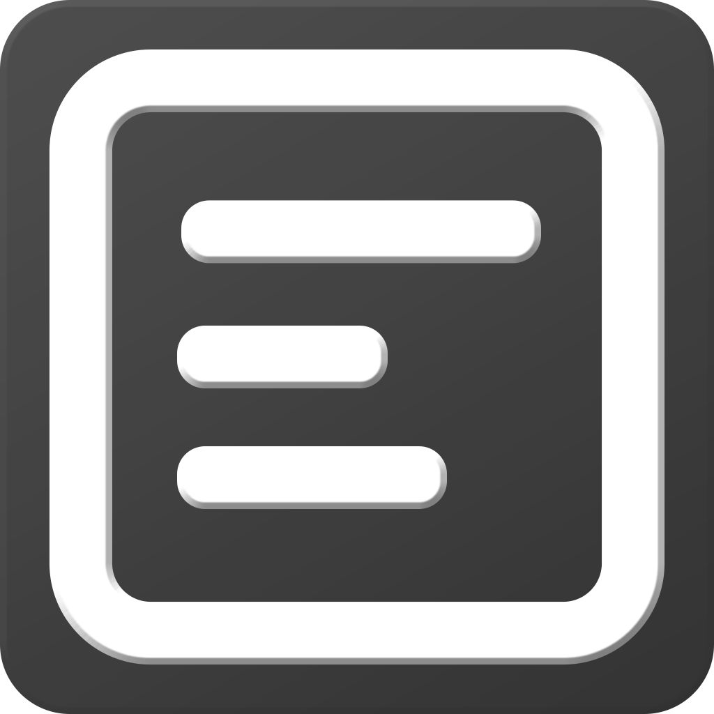

[![Contributors][contributors-shield]][contributors-url]
[![Forks][forks-shield]][forks-url]
[![Stargazers][stars-shield]][stars-url]
[![Issues][issues-shield]][issues-url]
[![GPL-3.0 License][license-shield]][license-url]

<!-- PROJECT LOGO -->
 

  

  <h2 align="center">MyNotes</h2>

  <h3>Version 2.0 — Rebuilt and modernized</h3>

  

    A simple notes and reminders app for Windows, built with WinUI 3 and C#.
     <!--
    <a href="https://github.com/othneildrew/Best-README-Template"><strong>Explore the docs »</strong></a>
     -->
    <a href="https://github.com/Erencrypt/MyNotes/issues">Report a bug</a>
    ·
    <a href="https://github.com/Erencrypt/MyNotes/issues">Request a feature</a>
  

<!-- TABLE OF CONTENTS -->

  
Table of Contents

  <ol>
    <li>
      <a href="#about-the-project">About the Project</a>
      <ul>
        <li><a href="#built-with">Built With</a></li>
      </ul>
    </li>
    <li>
      <a href="#getting-started">Getting Started</a>
      <ul>
        <li><a href="#system-requirements">System Requirements</a></li>
        <li><a href="#prerequisites">Prerequisites</a></li>
        <li><a href="#installation">Installation</a></li>
        <li><a href="#upgrading-from-v124">Upgrading from v1.2.4</a></li>
      </ul>
    </li>
    <li><a href="#usage">Usage</a></li>
    <li><a href="#roadmap">Roadmap</a></li>
    <li><a href="#contributing">Contributing</a></li>
    <li><a href="#license">License</a></li>
    <li><a href="#acknowledgments">Acknowledgments</a></li>
  </ol>

<!-- ABOUT THE PROJECT -->
## About the Project

[![MyNotes screenshot][product-screenshot]]()

I simply wanted to create a good-looking notes and reminders app that utilizes the Windows notification system. I also liked the look of WinUI design.

This app started as a side project that I aimed to use daily while continuing to develop it. Life had other plans, and I wasn't able to spend as much time on the project, but I never forgot about it or abandoned it.

The original version was created with .NET 7 and Template Studio. I later tried upgrading it to .NET 8 for long-term support, but WinUI wasn't getting much attention at the time, and it was unstable. Some parts broke, and I encountered strange errors that were difficult to trace back to their causes, so I left it alone for a while. But I was determined to return someday and rewrite it.

Now rewritten in .NET 10 and modernized.

"Behold my creation, in all its glory!" -me

## What's New in Version 2.0

- The new version uses SQLite with Entity Framework Core instead of JSON and RTF files.
- The notification service and reminders are more reliable.
- A tray icon provides quick access while the app runs in the background. Double-click it to bring the app to the foreground, or right-click it to open the menu.
- Settings include:
  - Language selection (currently English and Turkish)
  - 12-hour or 24-hour time format
  - Looping alarm sound for alarm reminders; when disabled, the sound plays once
  - **Notification priority:** High priority is the recommended setting for reminders that need to appear over full-screen apps. Back when I played CS, these notifications could steal focus and play the alarm sound over the game, sometimes costing me a round :D. Normal priority respects Windows notification settings and restrictions.
  - **Trash retention:** Items are permanently deleted after 30 days by default. The retention period can be changed to 5, 15, 45, 60, or 90 days, or set to Never. Each item's own deletion date is considered.

Version 2.0 includes many other changes and improvements. Rather than trying to list every difference, I encourage you to explore the new version and see what's changed.

(<a href="#readme-top">back to top</a>)

### Built With
These are the main frameworks and libraries used to build MyNotes. Additional libraries and resources are listed in the Acknowledgments section.

[![csharp][csharp]][csharp-url] [![wasdk][wasdk]][wasdk-url] [![win3][win3]][win3-url]  
[![devwinui][devwinui]][devwinui-url] [![notifyicon][notifyicon]][notifyicon-url]

(<a href="#readme-top">back to top</a>)

<!-- GETTING STARTED -->
## Getting Started

### System Requirements
MyNotes 2.0 is built with .NET 10 and WinUI 3. Windows 10 compatibility has not been verified for version 2.0 and later. Windows 11 is recommended.

### Prerequisites
The installer should handle the required dependencies where possible. If a dependency is missing, you may need to install the appropriate .NET 10 and Windows App SDK components.

### Installation
1. Download `MyNotes_x64.msi` from the [GitHub Releases](https://github.com/Erencrypt/MyNotes/releases) page.
2. Run the installer and follow the setup wizard.
3. Launch MyNotes using the shortcut created by the installer.
4. **Enable "Open on startup" in the app's settings** to help ensure reminders work reliably.

### Upgrading from v1.2.4
Version 2.0 introduces a new SQLite database, replacing the previous JSON and RTF file-based storage. Existing data must be migrated using the separate migration tool.

1. Install and launch MyNotes 2.0 once to allow it to create its database.
2. Close MyNotes before running the migration tool.
3. Run the migration tool and follow its instructions to transfer your existing data.

Keep a backup of your old data before migrating.

(<a href="#readme-top">back to top</a>)

<!-- USAGE EXAMPLES -->
## Usage

MyNotes is designed to be straightforward to use, with tooltips and visual guidance throughout most of the interface.

### Notes

1. Open the **Notes** page and click **Add**.
2. Write and format your note in the Note Editor.
3. Save your changes. Your note will then be available from the Notes page.

### Reminders

When creating a reminder, configure the following fields:

- **Header:** The reminder's name. Required.
- **Text:** The reminder's message. Required.
- **Time:** The time when the reminder should trigger. If not selected, the current time is used.
- **Date:** The date for a one-time reminder.
- **Repeat:** Enable this to repeat the reminder daily at the selected time. Optional; disabled by default.
- **Active:** Determines whether the reminder will trigger. Disable this to keep a reminder saved without it running.
- **Alarm:** Choose between a normal Windows notification with its notification sound and an alarm notification with the alarm sound.
- **Note:** A note-selection option is available in the interface, but linking reminders to notes is not yet implemented.

You can manage reminders from the **Reminders** page. When a reminder triggers, you can snooze or dismiss its notification. Dismissing a one-time reminder moves it to Trash.

When MyNotes starts, it checks for expired reminders and notifies you about expired and current reminders. Expired reminders are moved to Trash, and you can use the notification's button to view the deleted items.

### Planner

The Planner starts with three default lists: **To Do**, **In Progress**, and **Done**.

- Add a list using the button in the top-right corner, then give it a name and choose a color.
- Add items to a list or edit existing lists and items using the available controls.
- Use the reorder controls to change the order of your lists.

### Trash

Deleted notes, reminders, lists, and other items go to the **Trash** page, where you can restore them or delete them permanently.

By default, items in Trash are permanently deleted after 30 days. You can change the retention period or disable automatic deletion in Settings.

### Startup

Enable **Open on startup** in Settings to add MyNotes to your Windows startup apps. Manage this option from within MyNotes rather than changing it through Task Manager.

(<a href="#readme-top">back to top</a>)

<!-- ROADMAP -->
## Roadmap
- [x] Recreation and modernization
- [ ] Connect notes to reminders, so clicking a reminder notification opens its associated note (initial groundwork is in place; implementation is still needed)
- [ ] Add list ordering and filtering options
- [ ] Add speech-to-text for notes
- [ ] Add an option to export notes as files
- [ ] Support images in notes (not currently a priority)
- [ ] Add a task view page
- [ ] Add weekly and monthly planner views
- [ ] Explore options for cloud backup
- [x] Localization
  - [x] English
  - [x] Turkish
  - [ ] Additional languages may be added in the future
  - [x] Contributions to translations are welcome; open a feature request if you'd like to help

See the [open issues](https://github.com/Erencrypt/MyNotes/issues) for a full list of proposed features and known issues.

(<a href="#readme-top">back to top</a>)

<!-- CONTRIBUTING -->
## Contributing

Contributions, suggestions, and feedback are welcome!

- **Report a bug:** Open an issue on [GitHub Issues](https://github.com/Erencrypt/MyNotes/issues) and describe the problem you encountered.
- **Request a feature:** Open an issue to suggest an improvement or discuss a new feature before starting work on it.
- **Contribute code:** Fork the repository, make your changes, and submit a pull request.
- **Help with translations:** Contributions to existing translations or new languages are welcome. Open a feature request if you'd like to help.

If you find MyNotes useful, consider giving the project a star. Thanks for your interest and support!

(<a href="#readme-top">back to top</a>)

<!-- LICENSE -->
## License

Distributed under the **GNU General Public License v3.0** License. See [`LICENSE`](https://github.com/Erencrypt/MyNotes/blob/main/LICENSE) file for more information.

(<a href="#readme-top">back to top</a>)

<!-- ACKNOWLEDGMENTS -->
## Acknowledgments

These are the resources that helped me during development and that I'd like to give credit to.

- **Stack Overflow:** I fixed the app's lifecycle handling and replaced the old solution, but I'm leaving [this question](https://stackoverflow.com/questions/59706160/c-sharp-dot-net-core-single-instance-app-passing-parameters-to-first-instance) here in case it helps someone else.
* [Choose an Open Source License](https://choosealicense.com)
* [Best-README-Template](https://github.com/othneildrew/Best-README-Template).
* The installer tool will be listed here once implemented.

(<a href="#readme-top">back to top</a>)

<!-- MARKDOWN LINKS & IMAGES -->
<!-- https://www.markdownguide.org/basic-syntax/#reference-style-links -->
[contributors-shield]: https://img.shields.io/github/contributors/Erencrypt/MyNotes.svg?style=for-the-badge
[contributors-url]: https://github.com/Erencrypt/MyNotes/graphs/contributors
[forks-shield]: https://img.shields.io/github/forks/Erencrypt/MyNotes.svg?style=for-the-badge
[forks-url]: https://github.com/Erencrypt/MyNotes/network/members
[stars-shield]: https://img.shields.io/github/stars/Erencrypt/MyNotes.svg?style=for-the-badge
[stars-url]: https://github.com/Erencrypt/MyNotes/stargazers
[issues-shield]: https://img.shields.io/github/issues/Erencrypt/MyNotes.svg?style=for-the-badge
[issues-url]: https://github.com/Erencrypt/MyNotes/issues
[license-shield]: https://img.shields.io/github/license/Erencrypt/MyNotes.svg?style=for-the-badge
[license-url]: https://github.com/Erencrypt/MyNotes/blob/main/LICENSE
[product-screenshot]: ReadmeResources/AppImage.png
[csharp]: https://img.shields.io/badge/C_Sharp-239120?style=for-the-badge&logo=csharp&logoColor=white
[csharp-url]: https://learn.microsoft.com/en-us/dotnet/csharp/
[wasdk]: https://img.shields.io/badge/Windows_App_SDK-0078D4?style=for-the-badge&logo=windows11&logoColor=white
[wasdk-url]: https://learn.microsoft.com/en-us/windows/apps/windows-app-sdk/
[win3]: https://img.shields.io/badge/WinUI_3-ffb900?style=for-the-badge&logo=windows11&logoColor=white
[win3-url]: https://learn.microsoft.com/en-us/windows/apps/winui/winui3/
[devwinui]: https://img.shields.io/badge/DevWinUI-2e63ba?style=for-the-badge&logo=windows11&logoColor=white
[devwinui-url]: https://github.com/ghost1372/DevWinUI
[notifyicon]:https://img.shields.io/badge/wpf_notifyicon-2e63ba?style=for-the-badge&logo=windows11&logoColor=white
[notifyicon-url]:https://github.com/hardcodet/wpf-notifyicon 